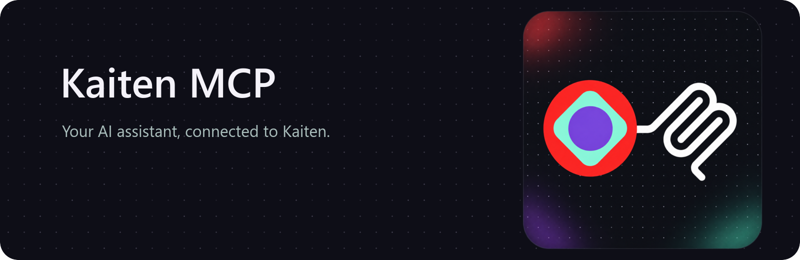

# Kaiten MCP



**Your AI assistant, connected to Kaiten.**

[](https://www.npmjs.com/package/@2chevskii/kaiten-mcp)
[](https://github.com/2chevskii/kaiten-mcp/actions/workflows/ci.yml)


Find cards, understand what's blocking them, and keep work moving without leaving
your assistant. Kaiten MCP runs locally and gives your MCP client **51 tools** for
working with your Kaiten company through its API.

[Get started](#get-started) ·
[Documentation](https://2chevskii.github.io/kaiten-mcp/)

## What you can do

- **Find your work:** browse spaces and boards; search cards by owner, member,
  responsible user, deadline, tag or state.
- **Get the context:** read card descriptions, comments, checklists, external
  links, and parent and child card references.
- **Keep cards moving:** create, edit, move, archive, restore or delete cards;
  manage comments, members, tags and external links.
- **Break down tasks:** create checklists, assign items, mark them complete, and
  link existing cards as children.
- **Use custom fields:** discover existing properties, options and directory
  records, then assign values to cards.

See the [tool reference](https://2chevskii.github.io/kaiten-mcp/tools) for the full
list of tools and supported fields.

## Get started

You need **Node.js 24 or newer**, a **Kaiten API token**, and an **MCP client that
can launch a local stdio server**.

### 1. Add the server

Run the command for your client, replacing the company address and token. These
commands configure Kaiten for your user across projects. For configuration-file
examples, see the [setup guide](https://2chevskii.github.io/kaiten-mcp/guide).

#### Codex

```sh
codex mcp add kaiten --env KAITEN_ORIGIN=https://company.kaiten.ru --env KAITEN_TOKEN=YOUR_KAITEN_TOKEN -- npx --yes @2chevskii/kaiten-mcp@latest
```

#### Claude Code

```sh
claude mcp add --scope user --transport stdio kaiten --env KAITEN_ORIGIN=https://company.kaiten.ru --env KAITEN_TOKEN=YOUR_KAITEN_TOKEN -- npx --yes @2chevskii/kaiten-mcp@latest
```

Restart your client after setup. Node.js and npx must be available in its PATH.
Use the client's secret settings for the token where supported.

### 2. Check the connection

Your client should discover 51 tools with the `kaiten_` prefix. Ask your assistant:

> Identify my Kaiten user, then list the spaces I can access.

This verifies access to Kaiten with your token. For launch alternatives and setup
details, see the [setup guide](https://2chevskii.github.io/kaiten-mcp/guide).
If the server won't connect, start with
[troubleshooting](https://2chevskii.github.io/kaiten-mcp/troubleshooting).

## Try a task

Once connected, ask your assistant:

- "Find my overdue cards on the Support board."
- "Read this card, its comments and checklists, then summarize what's blocking it."
- "Create a release card on the Delivery board and add a checklist for testing,
  documentation and rollout."

The [workflow guide](https://2chevskii.github.io/kaiten-mcp/workflows) shows how
these requests translate into tool calls.

<!-- eslint-disable markdown/no-missing-label-refs -- GitHub alert syntax. -->

> [!IMPORTANT]
> Tools apply changes immediately using your token's permissions. Your MCP client
> controls approval of tool calls. Requests are not automatically retried; after a
> write times out, check the affected card before repeating it.

<!-- eslint-enable markdown/no-missing-label-refs -->

## Configuration

| Variable            | Required | Description                                                                                     |
| ------------------- | -------- | ----------------------------------------------------------------------------------------------- |
| `KAITEN_ORIGIN`     | Yes      | Company origin, such as `https://company.kaiten.ru`, without an API path, query or fragment.    |
| `KAITEN_TOKEN`      | Yes      | Kaiten API token used for all requests.                                                         |
| `KAITEN_TIMEOUT_MS` | No       | Timeout per tool operation in milliseconds. Default: `30000`. Integer from `1` to `2147483647`. |

Each server entry connects to one company with one token. Add separate entries
with unique names to connect to several companies.

The server communicates over **stdio**. Your MCP client starts the process and
sends it tool calls; diagnostics go to stderr. Running it in a terminal may look
idle while it waits for MCP input.

This version focuses on cards and related data. Documents, attachments, time
tracking, automation, administration, webhooks, and editing custom-field
definitions or directories are outside its scope.

## Development

From a checkout, install dependencies and run all checks:

```sh
npm ci
npm run check
```

The checks build the server, check types, run tests, lint and formatting checks,
and build both documentation languages. Tests use the real Kaiten client library
against a local HTTP fixture.

See the [development guide](https://2chevskii.github.io/kaiten-mcp/development) for
the project structure and local workflow, and the
[release guide](https://2chevskii.github.io/kaiten-mcp/releasing) for package channels
and publishing.
